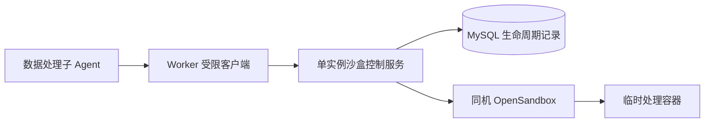
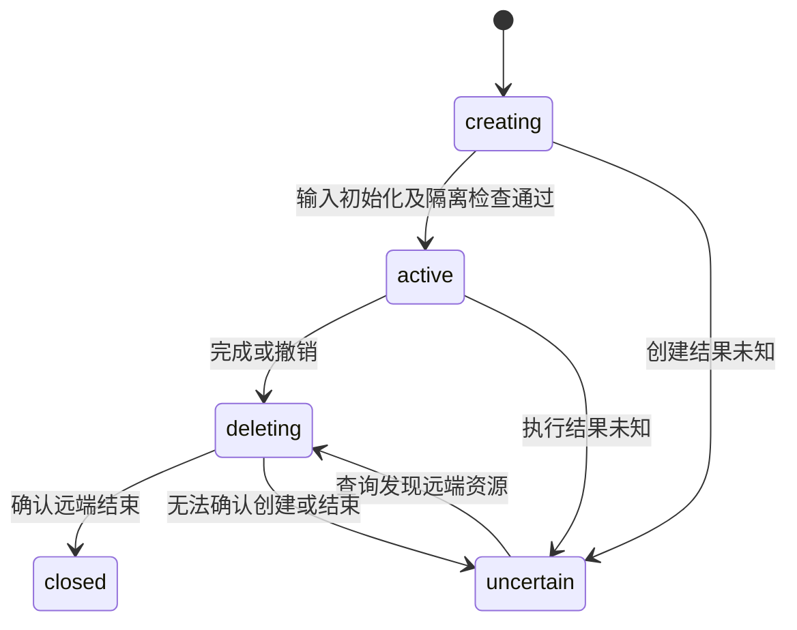

# 沙盒控制服务

文档职责：定义沙盒控制 API、资源生命周期、容量准入和故障恢复的当前契约。

适用范围：`sandbox_controller/`、Worker 沙盒客户端、`Database/sandbox_sessions.py` 及单机 OpenSandbox 部署；研究参数见 [Agent 运行时](agent-runtime.md)，部署文件见 [部署说明](../development/deployment.md#opensandbox-数据处理沙盒)。

## 组件与权限

Worker 仅持有独立控制服务 token，不持有 OpenSandbox 上游 key，不连接 Docker daemon。控制服务使用独立数据库密钥文件和上游 key 文件。OpenSandbox 持有同机 Docker socket；现有 Alloy 日志采集权限保留，本轮权限拆分只覆盖沙盒链路。两个内部 API 不发布宿主端口；Worker 不加入上游网络。

服务入口为 `python -m sandbox_controller`，固定一个 API 进程。启动先持有 MySQL `GET_LOCK`，再分页读取所有未关闭资源并核查；完成后才开放准入。第二个控制进程不能取得命名锁。命名锁连接失效时，当前服务停止接受执行和新建请求。

## 内部 API

全部业务请求要求独立 Bearer token 与 HMAC。签名绑定方法、路径、正文 hash、时间和 `job_id/worker_id/attempt_count/lease_epoch`，允许 30 秒时差。服务从 MySQL 主库重新检查当前 Job 的运行状态、执行身份、心跳和冻结文件 hash；Worker 提供的字段不直接构成授权。

| 方法与路径 | 操作与限制 |
| --- | --- |
| `GET /healthz` | 返回就绪布尔值；不公开资源内容 |
| `POST /v1/sessions` | `request_id` 与 `source_hash`；幂等登记意图后创建远端资源 |
| `GET /v1/sessions/{id}` | 当前状态、执行状态及受限执行回执 |
| `PUT /v1/sessions/{id}/input` | 有限原始 CSV，hash 必须等于 Job 冻结输入 |
| `PUT /v1/sessions/{id}/script` | 有限 UTF-8 脚本，只写 `scripts/process.py` |
| `GET /v1/sessions/{id}/preview` | 只预览 `raw/original.csv` 的有限前缀 |
| `POST /v1/sessions/{id}/execute` | 校验 `operation_id/script_hash/plan_version`，固定运行 `python3 /workspace/scripts/process.py` |
| `GET /v1/sessions/{id}/output` | 只读成功执行产生的 `output/prepared.csv`，返回内容 hash |
| `POST /v1/sessions/{id}/heartbeat` | 更新使用方心跳，不续期远端资源 |
| `DELETE /v1/sessions/{id}` | 登记清理并核查远端结束；失败保留占用 |

创建时写入稳定申请 ID 到远端 metadata。一次会话只允许一个执行操作；首次执行先提交 `pending`，重复同操作只返回既有结果或待定状态。执行开始后不再允许覆盖脚本。服务端独立核对最新 Job 输入是否确认该方案版本。Worker 在执行请求超时后查询原操作，不发送新的执行操作。文件和日志在客户端与服务端分别限制大小；真正执行端使用流式回调和 `skip_accumulation=True`，不在 SDK 内无限累积输出。

申请 ID 由 Job、工具调用和冻结输入生成，不随 attempt 或 lease 改变；请求摘要另行绑定当次执行身份。Worker 接管后重放旧申请会明确冲突，不能继续使用旧会话。后台核查负责结束旧资源；需要重新处理时，通过新的工具调用申请会话，仍须通过容量和实时授权检查。

## 生命周期与容量

容量上限由启动配置给出，MySQL 不保存容量策略。`creating/active/deleting/uncertain` 全部计数，只有 `closed` 释放占用。进程内串行执行计数和创建意图登记；MySQL 使用短事务、Job 行锁和 session 版本 CAS，远端调用在事务外执行。容量不足返回 `409` 和 `Retry-After`，客户端在有界期限内等待，不建立持久等待队列。降低配置容量不会主动终止已有资源。

远端 TTL、使用方心跳和后台核查互相独立。本轮不续期；记录的到期时间不能超过绝对期限。正常完成立即清理，失联、撤销、到期和删除的 Job 由后台核查清理。状态记录不以 Job、Session 或用户为级联外键，因此业务删除后仍能找到遗留资源。

远端创建响应丢失时，控制服务按 metadata 查询原申请并清理已发现资源，不重发创建。查询未发现资源仍不能证明先前创建没有遗留；这种记录保持 `uncertain` 并保留占用，不能仅因时间经过而自动关闭。销毁失败保持记录并按配置间隔重试。启动恢复会清理上个控制进程留下的会话，不继续未知脚本。真实沙盒、网络隔离和完整 Job 的验收条件见 [测试入口](../development/testing.md#opensandbox-数据处理验证)。
