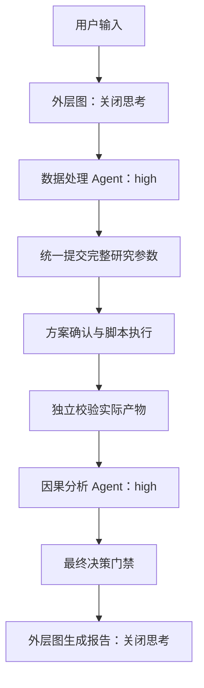

# 预处理重构交付与验证说明

文档职责：汇总本次分支的配置、验证证据、未完成验收和建议提交信息。功能日志唯一正文见下方链接。

适用范围：2026-10-29 的预处理结构重构与双模型思考配置，供代码审查和后续真实环境验收使用，不代表已经部署。

## 交付状态

分支：`refactor(preprocessing)/unified-research-spec`。代码修改完成，尚未提交、推送或创建 PR。研究参数由同一数据处理 Agent 通过 `set_research_spec` 提交完整草稿；不存在额外的参数审查模型。旧 checkpoint 需要重新发起任务，历史记录和产物保留。

完整功能更改日志见 [2026.10.29 开发记录](../../changelog/2026/2026-10.md)，运行流程见 [Agent 运行时](../../Document/architecture/agent-runtime.md)。

此图仅表示数据分析分支。上述脚本执行步骤属于生产实现；本次真实模型验收没有执行沙盒脚本。

## 模型配置

| 使用位置 | 配置 | 思考行为 |
| --- | --- | --- |
| 外层图 | `MODEL`、`BASE_URL`、密钥文件中的 `API_KEY` | 明确关闭 |
| 数据处理与因果分析两个 Agent | `DEEP_AGENT_MODEL`、`DEEP_AGENT_BASE_URL`、密钥文件中的 `DEEP_AGENT_API_KEY` | `DEEP_AGENT_REASONING_EFFORT=high` |

Agent 思考强度允许 `none`、`low`、`high`、`max`，非法值在初始化时拒绝。开发、预发、生产环境模板与三套 Compose 均已传递该项。现有业务容器没有重建，需在后续启动或重建 worker 时读取新配置。

DeepSeek 思考模式拒绝强制指定工具和 `required`；模型适配器改用 `auto`，同时保留工具 schema、统一参数工具、完成检查和最终决策门禁。外层结构化调用继续关闭思考。接口约束见 [DeepSeek 官方工具选择说明](https://api-docs.deepseek.com/api/create-chat-completion/)。

## 已执行验证

| 验证层级 | 结果 | 证据与边界 |
| --- | --- | --- |
| 核心参数、来源、测量映射、预处理状态和角色传递 | 192 项通过 | 真实纯函数和组件，包含本地算法执行；不代表模型或生产 HTTP |
| 模型构造、真实框架出站序列化、事件与推理过滤 | 25 项通过 | 真实模型实例与框架；序列化检查在出站前明确中止，不伪造响应 |
| 前端确认卡片与事件解析 | 23 项通过；类型检查、lint、构建通过 | 未运行模拟 API 的浏览器验收；构建仍有已有的大 chunk 提示 |
| 真实 MySQL/PostgreSQL 恢复 | 14/14 | [数据库报告](database-recovery.json)，正式迁移、Job 与确认账本、候选保存、实际校验、绑定和租约检查 |
| 真实参数工具、来源与 PostgreSQL 重连 | 通过 | [参数恢复报告](parameter-recovery.json)，原生中断、来源拒绝、同源纠正、重放、旧 checkpoint 拒绝与历史保留 |
| 开启 high 的工具续接和恢复 | 通过 | [推理恢复报告](reasoning-recovery.json)，真实参数工具、原生 interrupt/resume、连接池重建、正式因果 Agent 文件工具与结构化收尾 |
| 真实模型参数语义，high | 77/78，整体未通过 | [high 报告](model-parameters.json)，同义方案确认的 1 项观察单位和时间范围检查失败 |
| 真实模型参数语义，none | 76/78，整体未通过 | [none 报告](model-parameters-none.json)，2 项初始提交的重试请求返回 HTTP 400 |
| Compose 与文档 | 开发、预发渲染通过；三套 YAML 与新配置项检查通过 | 生产完整渲染因未提供发布制品的 `APP_IMAGE` 摘要而未完成；相对链接、Python AST、历史月日志前缀、根 README 未变与 diff 空白检查通过 |

模型两组使用相同源文件、13 个场景、三个入口、两次重复、8,192 token 输出上限和 90 秒请求超时。答复阶段由真实模型生成原提问或确认工具调用，再经过实际工具、Job resume、参数工具与数据库。未补造思考内容，也未用第二个模型判断参数是否正确。输出上限同时包含推理和可见输出。

样本结果不能证明关闭思考造成了此前的错误，也不能证明开启 high 后不会误读。high 的剩余失败是 `proposal_paraphrase_confirmation` 的提问答复入口；none 的剩余失败发生在 `scope_preserves_roles` 和 `proposal_partial_confirmation` 的初始入口。表中采用最终同版本对照结果，完整报告随附。

## 未执行及剩余风险

真实模型语义验收尚未全部通过，确认卡片展示当前参数供用户核对，但人工确认不构成模型理解正确的证据。本次没有执行完整自主规划、OpenSandbox 脚本、真实浏览器、MCP HTTP、SearXNG、主从回退、worker 崩溃接管或完整生产分析链路。因果 Agent 的真实模型检查使用状态后端中的明确测试文件，没有分析数据和领域算法工具，不证明因果算法选择正确。

专用验收容器、数据库和报告保留，结束时停止本次创建的四个容器；未删除容器、网络、数据库或产物。报告不包含模型凭据、服务端点、原始文件正文或思考正文。

## 建议提交与 PR 文案

建议按功能分成两个提交：

1. `refactor(preprocessing):统一研究需求提交与预处理状态`
2. `feat(agent):分离图模型与 Agent 思考配置并适配工具调用`

PR 标题：`refactor(preprocessing):统一研究参数契约并支持独立 Agent 思考配置`

PR 正文：

> 将首次需求、自由文本修改和同源纠正统一交由数据处理 Agent 的完整草稿工具处理。程序校验真实输入来源、修订、集合声明、列映射及方案授权，父图直接进入预处理，并显式拒绝旧 checkpoint。
>
> 外层图明确关闭思考，数据处理和因果分析 Agent 共用默认 high 的可配置模型；适配 DeepSeek 思考模式的工具选择限制，保留原有参数、完成和最终决策门禁。功能日志见 `changelog/2026/2026-10.md` 的 2026.10.29 记录。
>
> 验证：核心 192 项、模型配置与事件检查 25 项、前端 23 项及构建通过；真实数据库恢复和推理工具重连通过。真实模型 high 为 77/78，none 为 76/78，语义验收尚未全部通过；未验证完整生产沙盒和浏览器链路。
